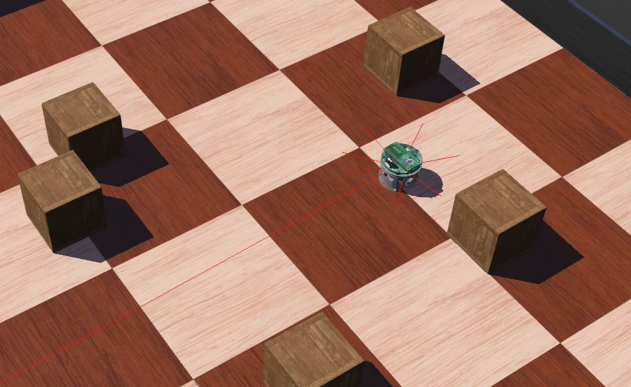
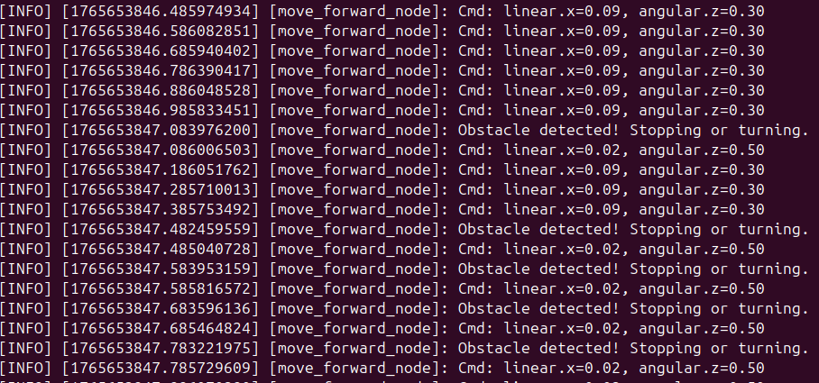
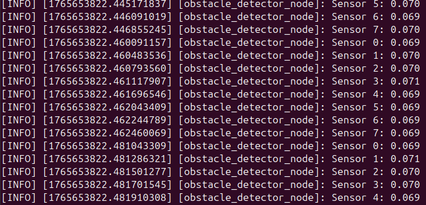
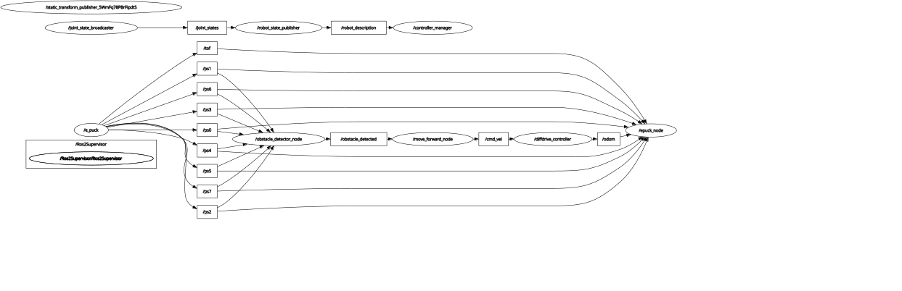

# ROS2 Demo: E-Puck Obstacle Avoidance

A ROS 2 project that moves an E-Puck robot in the Webots simulator and avoids obstacles using its infrared (IR) sensors. It was built as the practical part of a course report for DSCM140 "Autonomous Control Systems" (New Bulgarian University), on the topic *Autonomous control systems using ROS (Robot Operating System)*.

The project demonstrates core ROS 2 concepts: nodes, publishers, subscribers, timers and message passing.

## How it works

The package `epuck_demo` contains two nodes that communicate over the `/obstacle_detected` topic:

```
/ps0 … /ps7 (sensor_msgs/Range)
        │
        ▼
obstacle_detector_node ──/obstacle_detected (std_msgs/Bool)──▶ move_forward_node ──▶ /cmd_vel (geometry_msgs/TwistStamped)
```

### ObstacleDetectorNode (`obstacle_detector_node.py`)

- The E-Puck has 8 IR sensors, each published on its own topic (`/ps0` … `/ps7`).
- The node creates a subscription per sensor, and each callback stores the latest reading in `self.sensors`.
- A 0.1 s (10 Hz) timer calls `check_sensors`, which checks the front sensors (0, 1, 6, 7). If the minimum distance is below **4 cm**, it publishes `true` on `/obstacle_detected`, otherwise `false`.

### MoveNode (`move_node.py`, ROS node name `move_forward_node`)

- Subscribes to `/obstacle_detected`. The `obstacle_callback` updates the internal flag `self.obstacle`.
- A 0.1 s (10 Hz) timer calls `publish_command`, which checks `self.obstacle` and publishes a `TwistStamped` command on `/cmd_vel`:

| State       | `linear.x` (m/s) | `angular.z` (rad/s) |
|-------------|------------------|---------------------|
| Path clear  | 0.09             | 0.3                 |
| Obstacle    | 0.02             | 0.5                 |

## Requirements

- Ubuntu 24.04
- [ROS 2 Jazzy](https://docs.ros.org/en/jazzy/Installation/Ubuntu-Install-Debs.html), installed from Debian packages (`ros-jazzy-desktop`)
- [Webots](https://cyberbotics.com/), the 3D robot simulator by Cyberbotics, installed from its `.deb` package
- Webots ROS 2 integration with the robot simulations, including the E-Puck:

  ```bash
  sudo apt install ros-jazzy-webots-ros2
  ```

## Build

From the workspace root:

```bash
source /opt/ros/jazzy/setup.bash
colcon build
```

`colcon` finds every package under `src/`, builds it and installs it into the `install/` directory. For Python packages it also generates the required metadata from `setup.py`, so the nodes can be imported and run.

## Run

Source the workspace in every new terminal so that ROS can find the package:

```bash
source install/setup.bash
```

1. Start the Webots simulator with the E-Puck:

   ```bash
   ros2 launch webots_ros2_epuck robot_launch.py
   ```

   

2. In separate terminals, start the nodes:

   ```bash
   ros2 run epuck_demo obstacle_detector_node
   ```

   ```bash
   ros2 run epuck_demo move_node
   ```

The robot drives forward in a gentle curve. When an obstacle comes within 4 cm of the front sensors, it slows down and turns more sharply. The logs show the change: `move_forward_node` reports `Obstacle detected!` and switches from `linear.x=0.09, angular.z=0.30` to `linear.x=0.02, angular.z=0.50`. `obstacle_detector_node` logs each sensor reading.





## Visualizing the communication

Use `rqt_graph` to see the running nodes (ellipses), the topics (rectangles) and the publish/subscribe direction of the data flow:

```bash
rqt_graph
```



The graph shows the E-Puck driver publishing `/ps0` … `/ps7` to `obstacle_detector_node`, then `/obstacle_detected` to `move_forward_node`, then `/cmd_vel` back to the robot's controller.
